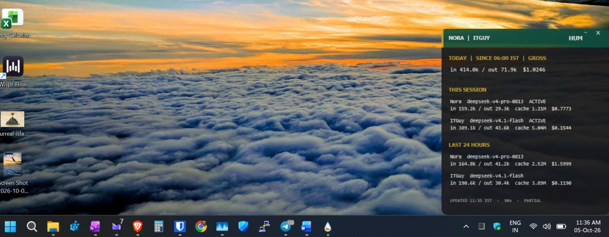

# HUM — Hermes Usage Meter



An always-on Windows desktop panel (Rainmeter skin) showing what this VPS's two Hermes
agents — **Nora** and **ITGuy** — are spending, plus the private server-side endpoint that
feeds it. A short visual walkthrough is in [`docs/widget-note.md`](docs/widget-note.md).

- **Today** — combined gross token spend for both agents since 06:00 IST
- **This session** — the current/last conversation per agent, with model, tokens, cache and cost
- **Last 24 hours** — the same two rows over a rolling 24 h window
- Polls a private endpoint every 90 s; on failure it keeps the last values and shows `STALE`

## Layout

| Path | Contents |
|---|---|
| `server/` | The endpoint: `hum_server.py` (HTTP), `hum_merge.py` (merge), `usage.py` (collector), `hum_sampler.sh`; `hum_billed.py` (provider-billed fetcher, run by its own 5-minute timer) |
| `server/systemd/` | The five units: `hum.service`, `hum-sampler.service`, `hum-sampler.timer`, `hum-billed.service`, `hum-billed.timer` |
| `windows/` | `HUM.ini` — the skin, with its endpoint already configured |
| `docs/` | The handover package: product description, PRD, mockup, handoff, deployment brief, Windows install guide, screenshot |
| `ops/` | The vetted install/control/observe scripts used on the host, plus `hum_integrity_watchdog.py` — the independent daily check that re-derives the provider's own total and compares it against what the widget actually serves |
| `nora/` | Nora's publisher and the package's tests |
| `history/` | Deployment audit for the initial build |
| `tests/` | The widget's regression suites (`test_billed.py`, `test_mediadup.py`) — run against the live code by the integrity watchdog every Saturday |

## How it works

Three moving parts, one direction of data:

1. **Nora's publisher** (her own scheduled job) writes a pre-aggregated export of her
   figures to a known file, roughly every minute and at zero model cost.
2. **The ITGuy endpoint** reads *its own* usage database and that export, merges them under
   a single lock, and serves exactly one route — `GET /hum` — returning a fixed ten-string
   display array.
3. **The skin** reads it every 90 seconds and renders it.

Notable properties, all deliberate:

- The endpoint binds to the **private Tailscale address only** — never `0.0.0.0` — and the
  tailnet policy restricts the port to the owner's own device. There is no public hostname.
- It is the **single writer** to its ledger, so concurrent requests cannot double-count.
- The service runs as an **unprivileged numeric uid** with a read-only filesystem apart from
  its state directory, and no capabilities.
- **No credentials exist in the skin.** Nothing sensitive is stored on the Windows side.
- Response bodies and query results are never logged — these are financial figures.

## Data boundary

ITGuy reads only its **own** usage database (read-only) plus Nora's published export. Neither
agent reads the other's conversation database, and nothing in this repository contains
credential material, message content, session titles or chat identifiers.

## Server-side operations

```bash
sudo -n /opt/itguy/vetted/obs_hum.sh                        # status, payload, ledger, coverage, feed freshness
sudo -n /opt/itguy/vetted/exec_hum_control.sh park 2|resume  # the supported way to hold the endpoint down
sudo bash /opt/itguy/temp/hum_stage/install_stage1.sh       # idempotent install/repair
```

Setup notes, rollback and the failures actually hit during deployment are in
[`docs/README-runbook.md`](docs/README-runbook.md).

## Windows setup

Rainmeter 4.5.26 or later, then place `windows/HUM.ini` in
`%USERPROFILE%\Documents\Rainmeter\Skins\HUM\` and load it (Manage → Load). Set
`Position` to **On Desktop** and leave **Click through** unchecked so the header controls
stay clickable. Full checklist: [`docs/06-windows-install.md`](docs/06-windows-install.md).

## Status

Live since 2026-10-05. End-to-end acceptance **closed 2026-10-17**: the endpoint serves, the
skin renders on the owner's desktop, and both outstanding items are now verified.

- **`STALE` failure path — verified.** A deliberate park held the endpoint down for 185 s. The
  panel kept its last figures and the footer swapped to
  `STALE · UPDATED <last success> IST · 90s · PARTIAL`, then recovered by itself when the
  self-limiting auto-resume fired.
- **Sustained refresh soak — verified.** 44 polls at 30 s intervals over 22.6 minutes: 44/44
  HTTP 200, 44/44 exactly ten display strings, no stall, no new ledger gap, no service restarts.

One correction to earlier guidance: `exec_hum_control.sh stop` **cannot** hold the endpoint
down — the 90 s sampler timer restarts the service within about a minute — so `park`/`resume`
are the only supported way to interrupt it. The initial build record is in
`history/2026-10-05-deployment-audit.md`.

### 2026-10-18 — footer `PARTIAL` bug fixed; reconciliation now `ok`

The footer used to read `PARTIAL` permanently. That was **not** a coverage problem: `usage.collect()`
is fed ITGuy only (by the data-boundary contract) but computed its `missing` list against a hardcoded
`('Nora','ITGuy')` tuple, so Nora always counted as missing and `today.partial` was structurally
`True`. The merge OR'd that into the footer. Fixed so only an agent that was *requested* and came
back empty counts. Healthy output is now `UPDATED <hh:mm> IST · 90s · EST. USD`; a stale export
(>300 s), an absent export, or a real ledger gap >180 s still raises `PARTIAL`.

Nora's publisher now reports `reconciliation: ok` with `difference_usd: 0.0`. Her old check compared
total `session_model_usage` cost — which includes auxiliary-task rows (background review, title
generation, approval, vision, image generation, compression) that never roll into a session summary —
against the sessions-summary cost, so it could never reconcile. The reconciliation fields are now
`status`, `total_cost_usd`, `session_summary_cost_usd`, `auxiliary_cost_usd`, `difference_usd`,
`checked_at`; the previous `model_usage_*` names are gone.

Note for reinstallers: `exec_hum_install.sh` does not restart an already-running `hum.service`
(`systemctl enable --now` is a no-op for a running unit), so a code change needs an explicit
`exec_hum_control.sh restart` and a PID check before the new code is actually live.
